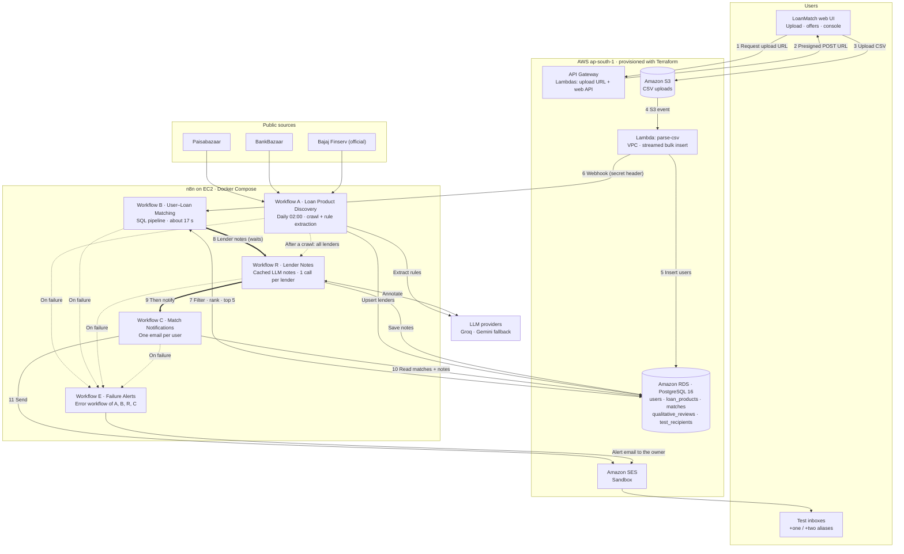

# Loan Eligibility Engine

Upload a CSV of users → crawl personal-loan products from the web → match every user to the lenders
they qualify for → email each user their best matches.

Built for the ClickPe engineering-internship assignment on **AWS (ap-south-1)** and a **self-hosted n8n**.
Everything is provisioned with Terraform, and the numbers below come from a real run on the supplied
10,000-user dataset.

| | |
|---|---|
| Users matched | **10,000** in **~17 s** (workflow B), upload → email in **~23 s** |
| Naive approach | 10,000 users × 45 lender records = **450,000** pairs |
| LLM calls in the matching path | **0** (naive LLM approach: 450,000) |
| LLM calls overall | one pass of **36** (one per lender, cached; unchanged lenders cost 0) |
| What each user gets | their **top 5** lenders, lowest rate first, with a credit-score check and lender conditions |

---

## 1. Architecture

One picture of the whole system: the AWS side, the five n8n workflows (A, B, R, C and the failure-alert workflow E) and how they hand off.


**Reading it (workflows A, B, R, C and E are the green boxes):** the numbers 1-11 are what happens on every upload. Thin arrows are data, thick arrows are workflow
hand-offs (B waits for R, then starts C), and the dotted arrow is the refresh after a crawl. Workflow A runs on its own
schedule and keeps the lender data fresh. A, B, R and C read and write the same RDS database; E mails the owner whenever one of them fails.

- Editable source: [`docs/architecture.excalidraw`](docs/architecture.excalidraw) (open it at [excalidraw.com](https://excalidraw.com) via *File, Open*; each box, its logo and its text are grouped)
- Regenerate the picture: `npm i roughjs && node scripts/build_architecture.cjs` (layout lives in that one file). Service logos are in `docs/icons/` and belong to their owners; they are used only to identify the services.

### Mermaid version

The same diagram as Mermaid text (renders on GitHub; source in [`docs/architecture.mmd`](docs/architecture.mmd)). It is
kept next to the picture above so either can be used.



### The five workflows

| | Workflow | Triggers | What it does | Nodes |
|---|---|---|---|---|
| **A** | Loan Product Discovery | schedule 02:00 daily, manual, `POST /webhook/crawl-now` | Reads three sources, pulls each lender's eligibility text, has an LLM turn it into per-employment-type numeric rules, upserts `loan_products`, then hands off to R | 21 |
| **B** | User-Loan Matching | `POST /webhook/batch-ready` (called by the parse-csv Lambda) | Multi-stage SQL funnel that matches 10,000 users and keeps each user's top 5. No LLM. Then calls R (waits) and C | 17 |
| **R** | Lender Notes | called by A and B, `POST /webhook/review-now`, manual | One LLM call per lender writes the short "good to know" note for each employment type it accepts. Cached by content hash, saved after every batch of 6 | 24 |
| **C** | Match Notifications | called by B, `POST /webhook/notify-now`, manual | One email per user via Amazon SES, to test aliases only; marks `notified_at` only after SES accepts | 15 |
| **E** | Failure Alerts | n8n starts it when A, B, R or C fails (their *error workflow* setting) | Mails the failure (workflow, node, error, link to the run) to the owner's verified SES address, so a failed run is never silent | 4 |

The workflow JSON in [`n8n/workflows/`](n8n/workflows) is generated by [`scripts/build_workflows.py`](scripts/build_workflows.py)
from the tested Code-node sources in [`n8n/code/`](n8n/code) and the SQL in [`n8n/sql/`](n8n/sql). I verified that the
files in the repo are identical (nodes and connections) to what n8n exports from the running instance.

---

## 2. The Optimization Treasure Hunt

**The problem.** 10,000 users × 45 lender records is 450,000 user-lender pairs. Asking an LLM "does this user
qualify?" for each pair means 450,000 calls: hours of waiting and a large bill. Even one call per user is 10,000 calls.

**The idea.** Use the LLM only where the input is unstructured text (the lender's web page), once per lender, and
do all per-user work in SQL on numbers. Candidate pairs never leave Postgres, so n8n's memory is never the bottleneck.

| Stage | What it does | Pairs left | Time |
|---|---|---:|---:|
| naive | every user × every lender record | **450,000** | |
| 0 · reconcile lenders (Code node) | the same bank on several sites collapses to one record (45 → 34 lenders, 11 merged groups) | 340,000 | <1 s |
| 1 · envelope pre-filter (SQL) | a permissive min/max per lender (a NULL means "no stated limit") drops the clearly ineligible, written to a staging table | 252,563 | ~5 s |
| 2 · exact rules (SQL over JSON) | per-employment-type rules, e.g. ICICI: Salaried needs ₹30,000, Self-Employed has no income floor | 242,095 | ~2 s |
| 3 · rank, keep top 5 (SQL window function) | flagged-score matches last, then lowest rate, then widest credit-score margin | **50,000** | ~1 s |
| LLM calls in all of the above | | **0** | |

Whole workflow B on the real 10,000-user batch: **16-18 s** end to end including the network hop to RDS.

**Be honest about where the savings come from.** Most lenders state loose requirements, so the numeric filters only
remove about 29% of the pairs (340,000 → 242,095). The big wins are (1) keeping the LLM out of the per-user path
entirely, (2) merging duplicate lenders, and (3) ranking to a top 5 so only 50,000 rows are written and mailed.

### What the LLM does, and how that is made cheap

The LLM reads lender web text twice, both times per lender and never per user:

1. **Extraction (workflow A):** eligibility text → structured rules (`min_income`, `min_credit_score`, `min_age`, `max_age`, per employment type). Only 2.5 KB of text per lender is sent, not an 800 KB page.
2. **Notes (workflow R):** a one-sentence "good to know" per employment type, e.g. *"You need at least 1 debit and 2 credit transactions a month in your main account."*

| Cost control | Effect |
|---|---|
| One call per lender, not per employment type | the prompt and lender text are sent once; 87 notes need only 36 calls |
| Cached by `md5(prompt version + the lender's raw page text)` | unchanged page → **0 calls**; the key deliberately excludes the LLM-written summary, which varies on every crawl even for an identical page |
| Notes for matched lenders first | after an upload, R reviews only the lender + employment-type pairs in that batch's matches (17 segments for the test batch, 12 already cached), and the emails wait for exactly those |
| Everything else in the background | A asks R for all lenders after each crawl, so the cache is complete before any outlier user needs it |
| Saved after every batch of 6 | a restart or a rate limit loses at most one batch |
| Groq primary, Gemini fallback | two free-tier quotas; a model that runs dry can be swapped in one line |

**Users growing never costs more LLM calls.** Notes belong to a lender and an employment type, not a person.
Only a change in a lender's text triggers a re-review of that lender.

---

## 3. Repository layout

```
infra/                 Terraform: VPC wiring, RDS, S3, Lambdas, API Gateway, n8n EC2, SES, IAM
  serverless.yml       Serverless Framework definition of the Lambda layer: 3 functions, HTTP API, S3 trigger
  serverless_vars.js   helper variable file for serverless.yml (splits the subnet list)
lambdas/
  get_upload_url/      presigned S3 POST (size-capped, content-type pinned, access key required)
  parse_csv/           streams the CSV, validates, bulk-inserts; notifies n8n
  api/                 read side of the web UI: summary, lenders, customer lookup, instant match
db/migrations/         001-008, idempotent, applied by scripts/migrate.sh
n8n/
  workflows/           A, B, R, C, E (importable JSON)
  code/                Code-node sources + prompts, with Node unit tests in code/test/
  sql/                 every SQL statement the workflows run
  docker-compose.yml   n8n 2.44.4, pinned
ui/                    the LoanMatch web app (index.html, styles.css, app.js) and its tests in ui/test/
scripts/               build, deploy, credentials, seeding, status and progress tools
docs/                  architecture diagram (png, svg, editable .excalidraw, Mermaid), the demo-video checklist and a one-page system explainer
```

---

## 4. Setup and deployment

### Prerequisites
- AWS account with CLI credentials for **ap-south-1** (`aws configure`)
- Terraform ≥ 1.5, Docker (used for `psql`), Python 3.10+, Node 20+ (tests only)
- A **Groq** API key and a **Gemini** API key
- A Gmail address (SES sender + `+one` / `+two` test aliases)

### Steps

```bash
# 1. Configure (gitignored file)
cp infra/terraform.tfvars.example infra/terraform.tfvars
#    edit: my_ip_cidr (curl https://checkip.amazonaws.com), ses_sender_email, test_recipient_emails

# 2. Build the Lambdas and create all AWS infrastructure
./scripts/build_lambdas.sh
terraform -chdir=infra init && terraform -chdir=infra apply
#    -> also writes loan-engine-n8n.pem (gitignored) for SSH to the n8n host

# 3. Click the 3 SES verification links AWS emails to your Gmail (sender + two aliases).
#    SES in sandbox mode sends only to verified addresses.

# 4. Create the database schema
./scripts/migrate.sh

# 5. Open n8n (terraform -chdir=infra output n8n_url) and create the owner account.
#    n8n v2 has no basic-auth env vars: the first visitor becomes the owner, which is why port
#    5678 is locked to your IP by the security group.

# 6. Load credentials into n8n (see the table below), then deploy the workflows
GROQ_API_KEY=... GEMINI_API_KEY=... ./scripts/n8n_credentials.sh
./scripts/n8n_ses_credential.sh
./scripts/n8n_webhook_credential.sh
./scripts/n8n_deploy_workflows.sh
# every webhook needs this header
export WEBHOOK_SECRET=$(terraform -chdir=infra output -raw webhook_secret)

# 7. Fetch lender data once, then fill the notes cache
# ~6 min; ends by starting workflow R
curl -X POST -H "X-Webhook-Secret: $WEBHOOK_SECRET" http://<n8n-ip>:5678/webhook/crawl-now
#    (or POST /webhook/review-now to run only the notes)

# 8. Open the web UI (home, instant "Check offers", lenders, and the console where you upload the CSV)
# open http://localhost:8000
./scripts/write_ui_config.sh && python3 -m http.server 8000 --directory ui

# 9. First time only: choose who gets emailed, then notify
# maps 2 real user_ids to your +one/+two aliases
./scripts/seed_test_recipients.sh
curl -X POST -H "X-Webhook-Secret: $WEBHOOK_SECRET" http://<n8n-ip>:5678/webhook/notify-now
```

After step 9, every upload runs the whole chain by itself: upload → Lambda → B → R → C → email.

### Deploying the Lambda layer with the Serverless Framework (alternative to Terraform's Lambdas)

Terraform creates the network, database, bucket, IAM roles, SES and the n8n host, and it deploys the Lambdas too. If you would rather deploy the function layer with the Serverless Framework, [infra/serverless.yml](infra/serverless.yml) defines the same three functions (`getUploadUrl`, `parseCsv`, `api`), the HTTP API routes with CORS, and the S3 trigger. It reuses Terraform's least-privilege roles, security group and secrets instead of creating its own:

```bash
# 1. Terraform first (network, RDS, bucket, roles), then build the zips
./scripts/build_lambdas.sh
terraform -chdir=infra apply
# 2. Read Terraform's outputs into TF_* variables (printed to your shell only, never to a file)
eval "$(./scripts/serverless_env.sh)"
# 3. Deploy; the default stage "sls" names everything loan-engine-sls-...
cd infra && npx serverless@3 deploy --stage sls
```

Notes: a bucket has one notification configuration, so send uploads through either stack's `parseCsv`, not both at once. Serverless v3's schema does not list `python3.12` yet, so `serverless print` shows one `provider.runtime` warning; it is only a warning, and 3.12 is what Terraform runs. This file was validated with `serverless print` (all three functions, six routes, subnet list) but **not deployed**.

### Credentials, exactly as configured in n8n

`scripts/n8n_credentials.sh` and `scripts/n8n_ses_credential.sh` create these with **fixed ids**, so the workflow JSON
resolves them automatically. If you create them by hand in the UI instead (Credentials → Create), re-select each
credential on the nodes that use it.

| n8n credential (id) | Type | Fields | Where the value comes from |
|---|---|---|---|
| **Groq API** (`credGroq000000001`) | Header Auth | Name `Authorization`, Value `Bearer <key>` | your Groq key |
| **Gemini API** (`credGemini0000001`) | Header Auth | Name `x-goog-api-key`, Value `<key>` | your Gemini key |
| **Loan DB (RDS)** (`credPostgres00001`) | Postgres | host / port 5432 / database / user / password; **SSL = Require, "Ignore SSL Issues" ON** | `terraform output db_host db_name db_user` and `terraform output -raw db_password` |
| **Webhook secret** (`credWebhook000001`) | Header Auth | Name `X-Webhook-Secret`, Value `<secret>` | `terraform output -raw webhook_secret` (generated by Terraform; the parse-csv Lambda gets the same value) |
| **AWS SES (send-only)** (`credAwsSes0000001`) | AWS (IAM) | region `ap-south-1`, access key id, secret | `terraform output ses_access_key_id` and `terraform output -raw ses_secret_access_key` |

### Environment variables and where each lives

| Variable | Where | Purpose |
|---|---|---|
| `my_ip_cidr`, `ses_sender_email`, `test_recipient_emails`, `aws_region`, `db_*`, `*_instance_type` | `infra/terraform.tfvars` (gitignored; example provided) | Terraform inputs |
| `GROQ_API_KEY`, `GEMINI_API_KEY` | your shell, only when running `n8n_credentials.sh` | stored by n8n as encrypted credentials; never written to a file |
| `UPLOAD_BUCKET`, `MAX_UPLOAD_BYTES`, `API_KEY` | set on the `get-upload-url` Lambda by Terraform | target bucket, 100 MB cap, and the access key uploads must present |
| `DB_*`, `API_KEY` | set on the `api` Lambda by Terraform | read-only web API: database access and the access key for private routes |
| `DB_HOST/PORT/NAME/USER/PASSWORD`, `N8N_WEBHOOK_URL`, `N8N_WEBHOOK_SECRET` | set on the `parse-csv` Lambda by Terraform | database, the private n8n address and the webhook shared secret |
| `N8N_ENCRYPTION_KEY`, `N8N_HOST`, `WEBHOOK_URL`, `GENERIC_TIMEZONE` | `/opt/n8n/.env` on the EC2 host, generated by Terraform ([template](n8n/.env.example)) | n8n runtime |

**No secret is committed.** `.env`, `*.tfvars`, `*.pem`, `tfstate`, `ui/config.js` and `data/` are gitignored.

### Operating it

```bash
# live list of workflow runs (or the editor's Executions tab)
./scripts/n8n_status.sh
# live progress bar of the lender-notes cache
./scripts/watch_reviews.sh
# tear everything down when finished (stops the AWS cost)
terraform -chdir=infra destroy
```

### Tests

The same checks run on every push in GitHub Actions (`.github/workflows/ci.yml`): all test suites (including the UI) against a
Postgres service container, `terraform fmt` and `validate`, and a check that the committed workflow JSON is exactly
what `build_workflows.py` generates.

```bash
# 44 tests: normalisers, reconciliation, email, review flow, alerts
node --test n8n/code/test/*.test.js
# 12 tests (loader tests need a local Postgres, see the file header)
cd lambdas/parse_csv && python3 -m unittest -v test_parse_csv
# 12 tests (no database needed)
cd lambdas/api && python3 -m unittest -v test_api
# 12 simulated-browser tests of the web UI against a mock API
cd ui/test && npm install && ./run.sh
# independent recompute of every stored top 5 (see section 6)
./scripts/audit_matches.py
```

---

## Web UI and API

A dependency-free web app in [`ui/`](ui) (no build step), styled after clickpe.ai: floating pill navbar, Outfit + Poppins,
`#295BEE` blue with navy and green accents, 24 px cards and soft gradient blobs. It is a design study, not affiliated with ClickPe.

| Page | What it does | Needs the access key |
|---|---|---|
| **Home** | Hero, feature cards, today's lowest lender rates and a rate comparison, the 4-step process, FAQ | no |
| **Check offers** | Type income, score, age and employment type; get the top 5 lenders instantly (same ranking as the batch pipeline) | no |
| **Lenders** | Searchable catalogue: one record per bank, lowest starting rate, accepted types, minimum score | no |
| **Console → Overview** | Latest batch with a live pipeline stepper, KPIs, and the funnel (450,000 pairs → 50,000) | yes |
| **Console → Upload** | Drag-and-drop CSV, progress bar, then the pipeline stepper updates as B, R and C run | yes |
| **Console → Customers** | Find a person by name or id and see their stored offers and email status (the CSV address is never returned; test inboxes are masked) | yes |

The browser talks to the same HTTP API as the upload flow. `lambdas/api` adds these routes:

| Route | Purpose | Auth |
|---|---|---|
| `GET /lenders` | canonical lenders and rates (public web data) | none |
| `POST /match` | top 5 for one person, via the SQL function `match_user()` | none |
| `GET /summary` | latest batch, funnel numbers, notes coverage | `x-api-key` |
| `GET /users?q=` and `GET /users/{id}` | customer lookup and stored offers | `x-api-key` |
| `POST /upload-url` | presigned upload (starts the pipeline) | `x-api-key` |

The access key is generated by Terraform (`terraform output -raw api_key`); with no key configured the private routes stay
closed. `match_user()` is checked against the batch pipeline by `scripts/verify_match_user.sh` (3,000 users: 0 differences).
Every value shown in the UI is inserted as text, never as HTML, so nothing from the database or lender websites can inject markup.

---

## 5. Design decisions

**Ingestion**
- **Presigned-POST upload, then an S3 event.** The browser uploads straight to S3, so API Gateway's 10 MB limit and Lambda's timeout never touch the file. The `batch_id` is embedded in the object key (`uploads/<batch_id>/<file>.csv`), so the first Lambda needs no database and no VPC.
- **Streamed, chunked load.** `parse-csv` streams the file and inserts 1,000 rows at a time with a single `unnest` statement and `ON CONFLICT DO NOTHING`; the row count is recomputed from the table, so retries are idempotent. The 10,000-row file loads in about 1 s.
- **`user_id` is the primary key, not email.** The dataset has 10,000 rows but only 2,632 distinct emails, so email would silently drop most users. Notifications are grouped per `user_id`.
- **Least-privilege networking.** Default VPC with no NAT; an S3 gateway endpoint; separate security groups so RDS accepts only the Lambda, n8n and my IP, and n8n's UI, SSH and webhook accept only my IP and the Lambda.
- **RDS is publicly addressable, but only from my IP.** `publicly_accessible = true` exists so I can run `psql` and the audit scripts from a laptop without a bastion host. The security group admits only the Lambda, n8n and `my_ip_cidr` (Terraform refuses `0.0.0.0/0`), the volume is encrypted, and connections require TLS. In production I would make it private and reach it through SSM or a bastion.

**Infrastructure**
- **Terraform is the deploy path; `serverless.yml` is a full alternative for the function layer.** Terraform owns the VPC, RDS, S3, IAM, SES, EC2 and the Lambdas. The assignment lists Serverless Framework for deployment, so `infra/serverless.yml` defines all three functions, the HTTP API with its routes and CORS, and the S3 trigger, reusing Terraform's IAM roles, security group and secrets (`scripts/serverless_env.sh` reads them from Terraform's outputs). It passes `serverless print` but I never deployed it: both tools would then own the same bucket notification. Use one deploy path per environment.
- **n8n on a `t3.micro` with docker compose, over plain HTTP.** Good enough for a take-home, with port 5678 locked to my IP and every webhook additionally requiring a shared-secret header (Terraform-generated, held by the Lambda and in an n8n credential), so a stray call from inside the VPC cannot start a run. In production I would put it behind HTTPS (an ALB or Caddy) and a real domain.
- **DB password as a Lambda environment variable.** Simple and honest for this scope, but the value sits in Terraform state and the function config. Production would use Secrets Manager. State is local and gitignored.
- **n8n's Postgres credential is TLS-encrypted but not chain-verified.** The n8n credential cannot take a CA bundle; traffic stays inside the VPC. The Lambda does verify the RDS certificate with the bundled CA.
- **SES sandbox on purpose.** It only delivers to verified addresses, which is exactly the safety property required here.

**Matching**
- **Rules are per employment type.** Lenders differ by applicant (ICICI: salaried ₹30,000; self-employed none), so a single `min_income` per lender would be wrong. A permissive "envelope" (a NULL in any rule makes that bound NULL) makes Stage 1 a guaranteed superset of Stage 2.
- **Self-Employed implies Business.** Indian lenders use "self-employed" for professionals and non-professionals alike, while the CSV splits them into two categories, so a lender that accepts one accepts the other.
- **One record per lender, with an authority order.** The same bank appears on several sites with different thresholds. Eligibility rules come from the lender's own site first, then the record stating more criteria, then Paisabazaar before BankBazaar.
- **The rate is the lowest published across sources**, shown as "From X%". Aggregators disagree (Axis: 9.99% vs 8.75%) and a customer cares about the best published rate. The rate and the rules can therefore come from different sources.
- **Unstated is not "no limit".** When a lender states a minimum score for one applicant type and nothing for another, a user below that minimum is **flagged** ("Check: your score is 670; 700 is required for other applicants"), ranked behind unflagged matches, and the email shows the score against the minimum. After the extraction audit below, the live lender data happens to contain no such mismatch (flagged matches: 0 of 50,000), so this path is covered by unit tests and `match_user()` checks rather than by live rows.
- **Top 5, ranked.** Unflagged first, then lowest rate, then the widest credit-score margin. A user receives a short, useful list instead of 34 lenders.
- **The LLM annotates, it never removes.** A first version let the LLM veto segments; on real data it applied a salaried income floor to self-employed applicants and flipped between runs. So it may only mark a segment `eligible` or `conditional` with a caveat. An "ineligible" answer is demoted. Eligibility is decided only by exact SQL.

**Notifications**
- **Hard safety rail.** The notification query takes the recipient from `test_recipients` only and never selects `users.email`; users without a mapping are skipped. Real CSV addresses cannot be mailed.
- **Idempotent.** `notified_at` is set only for emails SES accepted, so a failed send is retried and a second run sends nothing.
- **Escaping.** Names and notes from the CSV or the web are HTML-escaped, and a newline in a name cannot inject a mail header.

---

## Scaling the ingestion (design notes, not built)

What is already in place: the browser uploads **straight to S3** (no API Gateway or Lambda size limit), the Lambda
**streams** the file and inserts **1,000 rows per statement**, and matching is set-based SQL. A 10,000-row file loads
in about 1 s; a few million rows fit inside the Lambda's 300 s limit.

For files in the tens of millions of rows (or several large uploads at once) I would add, in this order:

1. **S3 → SQS → Lambda.** Replace the direct S3 trigger with a queue so bursts are buffered and a failed file is retried
   or dead-lettered instead of lost; set the Lambda's reserved concurrency so it cannot overwhelm the database.
2. **Split large files.** A small "splitter" step writes byte ranges (S3 `Range` GETs) as separate messages, so many Lambdas
   load one file in parallel; `ON CONFLICT DO NOTHING` already makes overlapping retries safe.
3. **Protect the database.** Put RDS Proxy in front of it (Lambda connection storms) and move to a larger instance or
   Aurora Serverless v2; load into the staging table with `COPY` for the biggest batches.
4. **Make B incremental.** Matching a batch is already independent of other batches; for very large batches run Stage 1
   in user-id ranges so each statement stays short and the work can be spread over several n8n executions.

The LLM cost does not grow with users at all (see section 2), so nothing in this list involves the LLM.

---

## 6. Accuracy and known limitations

### How the output was validated

I checked the emails against the raw CSV and the live lender websites by hand, not against my own database:

1. **CSV → database → email.** The two emailed customers' rows are byte-identical in `data/users.csv` and RDS (all 10,000 rows load, 2,632 distinct emails).
2. **Rates.** The lowest published rate per lender, re-read from the live Paisabazaar and BankBazaar rate cards, equals every rate in the emails (for example Axis 8.75%, Bandhan 8.86%, Union Bank 8.90%).
3. **Eligibility.** For each emailed lender, and for the cheaper lenders that were skipped, I read the live eligibility text and checked it against the customer: ICICI's self-employed age band, IDFC FIRST's 760 score for self-employed applicants (so it is correctly absent for a 670 score), Indian Bank's 700 score floor, Bajaj's own page saying "CIBIL 650 or higher" (the aggregator's 685 is out of date), SBI and Kotak being salaried products.
4. **Independent recompute.** `scripts/audit_matches.py` re-derives all 10,000 top-5 lists in plain Python: 0 differences.

**What this found, and the fix.** The manual read exposed a real bug: the extraction prompt treated "doctors" as self-employed and
defaulted to "all three types" when a page named none, so salaried-only products (Axis, Canara) were matched to 6,611 and 2,302
self-employed or business customers. The prompt now grants those types only when the page says the general loan is open to them,
and a deterministic check drops them when the page never mentions self-employed applicants. After a re-crawl, Axis is matched to 0
non-salaried customers, and no match goes to a lender that does not accept the customer's employment type.

### Lender-by-lender audit of what the LLM is given

A second manual pass compared, for **all 45 lender records** (Paisabazaar, BankBazaar, Bajaj Finserv), the live page text, the text the LLM was actually given, and the rules it returned. It found that the context builder, not the model, was the weak point:

- It kept only the first two sections under an "eligibility"-style heading, so facts under other headings were never seen: IndusInd (BankBazaar) lists age and income under "For salaried employees", Canara under a scheme name ("Canara Ready Cash"), and HDFC and IIFL in an unlabelled "Eligibility Criteria" card. Those lenders reached the LLM with 67-700 characters of context and came back with no usable rules.
- Rate tables ("Credit Score-Based Risk Grade | Interest Rates") passed its key-facts filter and filled the context with noise.
- Advice such as "a score of 700 or above gives higher chances" was sometimes returned as a minimum credit score (Yes Bank, DMI Finance, PNB), which would wrongly flag or reject users.

Fixes: the context builder now (a) skips rate and fee tables, (b) caps each heading section so one long section cannot crowd out the rest, and (c) sweeps the whole page for sentences stating an eligibility fact, dropping sentences that repeat across five or more pages (site boilerplate), amounts, tenures and rates. The prompt states that soft guidance and "most lenders" statements are not requirements, and a deterministic guard drops any credit-score floor that is not backed by a non-advisory sentence in the context. Each has a unit test (`n8n/code/test/`).

Result after a full re-crawl: the median context grew from 743 to about 1,160 characters (none hit the 3,500 cap), the rules of 15 of the 45 records changed, and every change was checked against the page. IndusInd now has income ≥ 25,000 and age 21-65, Canara income ≥ 50,000 and age 21-55, HDFC gained its self-employed rule (income ≥ 20,000, age 21-65), and the three advisory scores above were removed. IDFC FIRST's 710 (salaried) and 760 (self-employed) are kept because the page states them as requirements. Matching was then re-run on a fresh upload: 10,000 users, 50,000 matches, 0 differences in both independent audits (`audit_matches.py` and `verify_match_user.sh`).

Known gaps found by the audit and not fixed:

- Moneyview and Paysense publish no detail link, so only their table rows are available, and one Bajaj Finserv entry duplicates another.
- The LLM is not fully deterministic between crawls: for Indian Bank (a profession-based overdraft scheme) one crawl returned salaried only and another all three types, because the page mentions licensed professionals. Both readings are defensible; the guards cannot arbitrate between them.
- Paisabazaar's income figures for some banks are its own estimates ("applicants with Rs 15,000 would be able to avail"), not the lender's stated minimum.

Remaining differences I did not "fix": lender detail pages sometimes quote a slightly lower starting rate than the comparison table
on the same site (Bandhan 8.82% vs 8.86%, Punjab & Sind 9.60% vs 9.90%, Canara 9.70% vs 9.95%); we use the rate-card numbers.

The matching logic is exact and verified: I re-derived every user's top 5 independently for all 10,000 users and found 0 differences. The data behind it is **public web text read by an LLM**, so the output is **indicative, not a guaranteed offer**.

- Extraction can miss a number, and a missing number becomes "no limit" (the score flag covers one important case, not all).
- Rates are headline "from" rates, not personalised offers; the lender decides.
- Most lenders publish no minimum credit score; the email says so ("Lender does not publish a minimum").
- The "good to know" notes are LLM-written. Spot checks found them faithful, but one framed a list of eligible groups as a condition.
- Free-tier LLM quotas are small and per model (Gemini ≈ 20 requests/day per model; Groq has per-minute and daily token caps). A throttled review simply retries on the next run, and no match depends on it.
- The crawler reads three public sources; Policybazaar redirects to Paisabazaar, so Bajaj Finserv's own site is the third.
- Not exercised live on AWS: the `webhook_failed` path (a failed n8n call from the Lambda) and a deployment of `serverless.yml` (it is validated with `serverless print` only).

---

