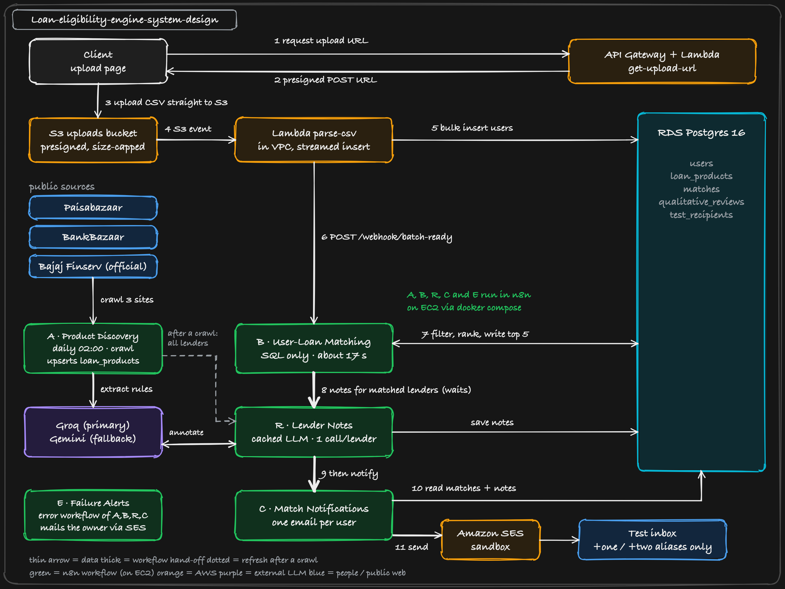
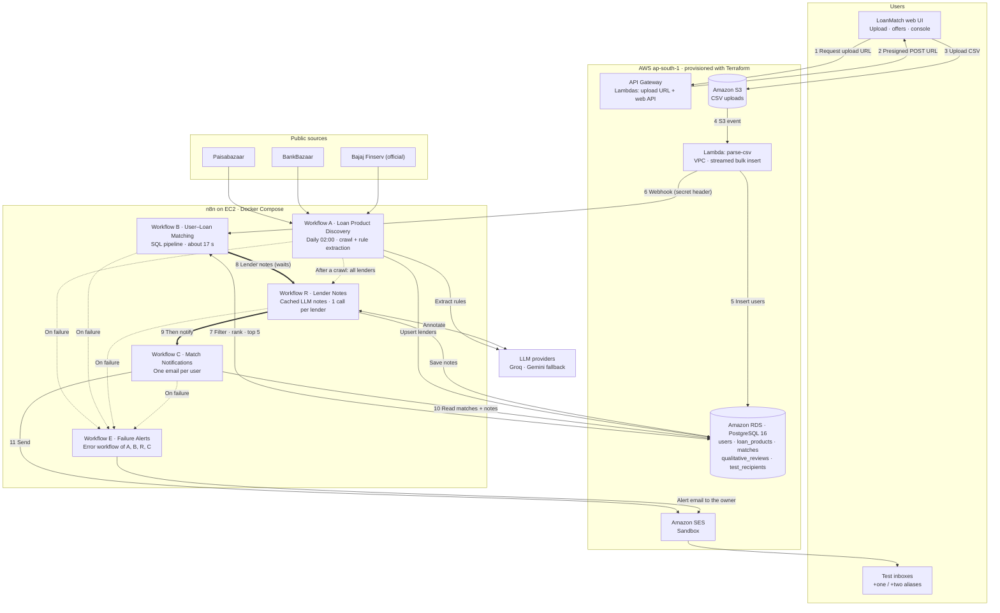
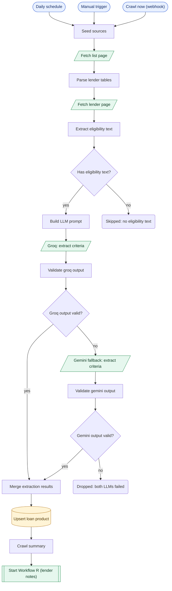
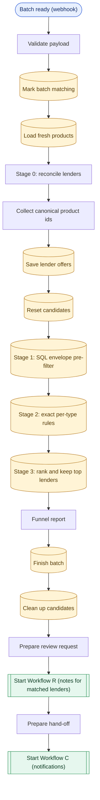
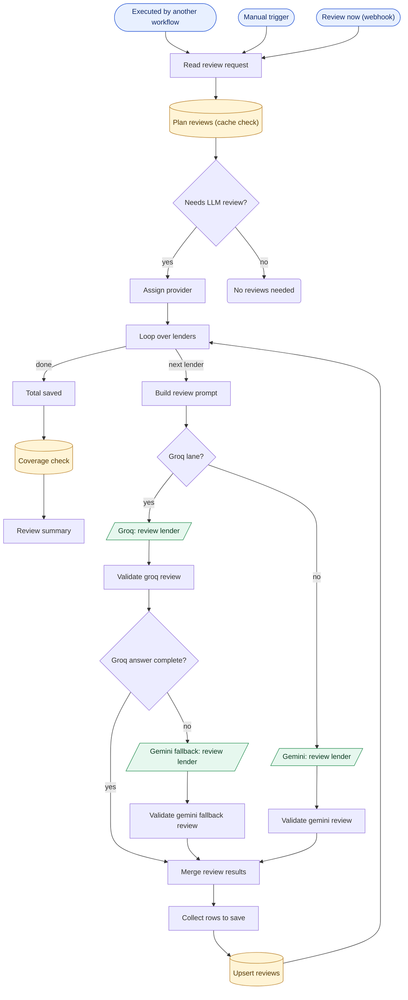
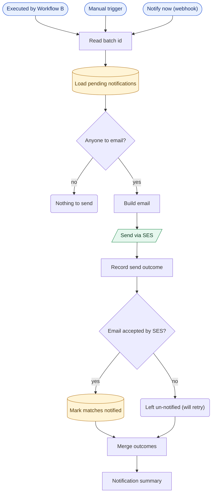
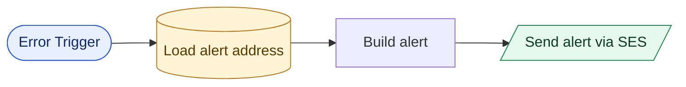

# Loan Eligibility Engine

Upload a CSV of users, crawl personal-loan products from the web, match each user to the lenders they qualify for, and email their best five. Built for the ClickPe engineering-internship assignment on AWS (ap-south-1) with a self-hosted n8n. The numbers below come from a real run on the supplied 10,000-user file.

| | |
|---|---|
| Users matched | 10,000 in about 18 s (workflow B); upload to email in about 20 s |
| Naive approach | 10,000 users x 45 lender records = 450,000 pairs |
| LLM calls while matching | 0 (a per-pair LLM approach would need 450,000) |
| LLM calls overall | one per lender, cached; an unchanged lender costs 0 |
| Each user gets | their top 5 lenders, lowest rate first, with a credit-score check and the lender's conditions |

---

## 1. Architecture



Numbers 1-11 are one upload. The browser gets a presigned URL from API Gateway, uploads the CSV straight to S3, and S3 triggers the parse-csv Lambda. That loads RDS and calls workflow B, which matches the users, waits for workflow R (lender notes), then starts workflow C to send the emails through SES. Workflow A runs daily and refreshes the lender data. Workflow E emails the owner when A, B, C or R fails.

Editable source: [`docs/architecture.excalidraw`](docs/architecture.excalidraw) (open it at excalidraw.com). To regenerate the picture: `npm i roughjs && node scripts/build_architecture.cjs`. The logos in `docs/icons/` belong to their owners and are only used to identify the services.

### Mermaid version

Same diagram as text, so it renders on GitHub. Source: [`docs/architecture.mmd`](docs/architecture.mmd).



### The five workflows

| | Workflow | Triggers | What it does | Nodes |
|---|---|---|---|---|
| A | Loan Product Discovery | daily 02:00, manual, `POST /webhook/crawl-now` | Reads three sources, cuts each lender page down to its eligibility text, has an LLM turn that into numeric rules per employment type, upserts `loan_products`, then starts R | 22 |
| B | User-Loan Matching | `POST /webhook/batch-ready`, called by the parse-csv Lambda | SQL funnel that keeps each user's top 5. No LLM. Then runs R (and waits) and C | 18 |
| R | Lender Notes | called by A and B, `POST /webhook/review-now`, manual | One LLM call per lender writes the "good to know" note for each employment type. Cached, saved every 6 lenders | 24 |
| C | Match Notifications | called by B, `POST /webhook/notify-now`, manual | One email per user through SES, to test aliases only | 15 |
| E | Failure Alerts | n8n's error-workflow hook on A, B, C and R | Emails the owner the workflow, node and error | 4 |

#### The workflows as drawn in n8n

<!-- workflows:start -->
Generated from the exported workflow JSON by [`scripts/build_workflow_diagrams.py`](scripts/build_workflow_diagrams.py), so it matches [`n8n/workflows/`](n8n/workflows). Blue rounded: trigger. Yellow cylinder: SQL. Green slanted: external call (LLM, web, SES). Double border: another workflow. Diamond: decision. Plain box: Code node.

<details>
<summary><b>Workflow A: Loan Product Discovery (the crawler)</b> (22 nodes, <a href="n8n/workflows/A_loan_product_discovery.json">A_loan_product_discovery.json</a>)</summary>

Rates come from the list page without an LLM. Each lender page is cut down to its eligibility text, Groq extracts the rules, and Gemini is the fallback.



</details>

<details>
<summary><b>Workflow B: User-Loan Matching (the multi-stage filter)</b> (18 nodes, <a href="n8n/workflows/B_user_loan_matching.json">B_user_loan_matching.json</a>)</summary>

Called by the parse-csv Lambda. SQL stages cut 450,000 user-lender pairs to a top 5 per user, then R and C run.



</details>

<details>
<summary><b>Workflow R: Lender Notes (the cached LLM reviews)</b> (24 nodes, <a href="n8n/workflows/R_lender_notes.json">R_lender_notes.json</a>)</summary>

One LLM call per lender, only when its page text changed. Groq and Gemini lanes, saved every 6 lenders.



</details>

<details>
<summary><b>Workflow C: Match Notifications (SES)</b> (15 nodes, <a href="n8n/workflows/C_match_notifications.json">C_match_notifications.json</a>)</summary>

One email per user to a test alias, marked sent only after SES accepts.



</details>

<details>
<summary><b>Workflow E: Failure Alerts (the error workflow)</b> (4 nodes, <a href="n8n/workflows/E_failure_alerts.json">E_failure_alerts.json</a>)</summary>

Started by n8n when A, B, C or R fails. Emails the owner the workflow, node and error.



</details>
<!-- workflows:end -->

The JSON in [`n8n/workflows/`](n8n/workflows) is generated by [`scripts/build_workflows.py`](scripts/build_workflows.py) from the tested Code-node sources in [`n8n/code/`](n8n/code) and the SQL in [`n8n/sql/`](n8n/sql). It is identical (nodes and connections) to what n8n exports from the running instance.

---

## 2. The Optimization Treasure Hunt

10,000 users x 45 lender records is 450,000 user-lender pairs. Asking an LLM about each pair would take hours and cost a lot, and even one call per user is 10,000 calls. So the LLM only reads lender web pages (once per lender), and everything per user is SQL on numbers. Candidate pairs never leave Postgres, so n8n's memory is not the limit.

| Stage | What it does | Pairs left | Time |
|---|---|---:|---:|
| naive | every user x every lender record | 450,000 | |
| 0. reconcile lenders (Code node) | the same bank on several sites becomes one record (45 to 34 lenders) | 340,000 | <1 s |
| 1. envelope pre-filter (SQL) | loosest min/max across a lender's rules (NULL means no stated limit), written to a staging table | 255,951 | ~5 s |
| 2. exact rules (SQL over JSON) | per-employment-type rules, e.g. ICICI wants Rs 30,000 from salaried, nothing from self-employed | 246,591 | ~2 s |
| 3. rank, keep top 5 (window function) | flagged-score matches last, then lowest rate, then widest score margin | 50,000 | ~1 s |
| LLM calls in all of this | | 0 | |

Workflow B takes 16-19 s on the 10,000-user batch, including the network hop to RDS.

The numeric filters only remove about 27% of the pairs, because most lenders state loose requirements. The real savings are keeping the LLM out of the per-user path, merging duplicate lenders, and ranking to a top 5 so only 50,000 rows are written and mailed.

### Where the LLM is used

Both uses are per lender, never per user.

1. Extraction (workflow A): the eligibility text becomes structured rules (`min_income`, `min_credit_score`, `min_age`, `max_age`, per employment type). About 1-3 KB of text is sent per lender, not an 800 KB page.
2. Notes (workflow R): one short "good to know" line per employment type.

What keeps it cheap:

- One call per lender, not per employment type.
- Results are cached by `md5(prompt version + the lender's page text)`. An unchanged page costs 0 calls. The LLM's own summary is left out of the key because it changes on every crawl.
- After an upload, R reviews only the lender and employment-type pairs in that batch's matches, and the emails wait for exactly those. A full pass runs after each crawl.
- Progress is saved every 6 lenders, so a rate limit loses at most one batch.
- Groq is the primary and Gemini the fallback, so two free quotas are in play.

More users never means more LLM calls. Only a changed lender page triggers a new review.

---

## 3. Repository layout

```
infra/                 Terraform: RDS, S3, Lambdas, API Gateway, n8n EC2, SES, IAM
  serverless.yml       Serverless Framework definition of the Lambdas, HTTP API and S3 trigger
  serverless_vars.js   helper for serverless.yml (splits the subnet list)
lambdas/
  get_upload_url/      presigned S3 POST (size-capped, access key required)
  parse_csv/           streams the CSV, validates, bulk-inserts, calls n8n
  api/                 read side of the web UI: summary, lenders, customer lookup, instant match
db/migrations/         001-008, applied by scripts/migrate.sh
n8n/
  workflows/           A, B, R, C, E (importable JSON)
  code/                Code-node sources and prompts, with Node unit tests in code/test/
  sql/                 every SQL statement the workflows run
  docker-compose.yml   n8n 2.44.4, pinned
ui/                    the web app (index.html, styles.css, app.js) and its tests
scripts/               build, deploy, credentials, seeding, status and audit tools
docs/                  architecture diagram, demo checklist, one-page explainer
```

---

## 4. Setup and deployment

### Prerequisites

- AWS account with CLI credentials for ap-south-1
- Terraform 1.5 or newer, Docker (used for `psql`), Python 3.10+, Node 20+ (tests only)
- A Groq API key and a Gemini API key
- A Gmail address (SES sender, plus `+one` and `+two` test aliases)

### Steps

```bash
# 1. Configure (the file is gitignored). Edit my_ip_cidr, ses_sender_email, test_recipient_emails.
cp infra/terraform.tfvars.example infra/terraform.tfvars

# 2. Build the Lambdas and create the AWS infrastructure. This also writes loan-engine-n8n.pem for SSH.
./scripts/build_lambdas.sh
terraform -chdir=infra init && terraform -chdir=infra apply

# 3. Click the 3 SES verification links AWS emails you (sender and the two aliases).
#    SES sandbox only delivers to verified addresses.

# 4. Create the database schema
./scripts/migrate.sh

# 5. Open n8n (terraform -chdir=infra output n8n_url) and create the owner account.
#    n8n v2 has no basic-auth variables, so the first visitor becomes the owner.
#    That is why port 5678 is limited to your IP.

# 6. Load the credentials into n8n (table below), then deploy the workflows
GROQ_API_KEY=... GEMINI_API_KEY=... ./scripts/n8n_credentials.sh
./scripts/n8n_ses_credential.sh
./scripts/n8n_webhook_credential.sh
./scripts/n8n_deploy_workflows.sh
export WEBHOOK_SECRET=$(terraform -chdir=infra output -raw webhook_secret)

# 7. Fetch lender data once (10 to 20 min on free-tier LLM quotas); it ends by starting workflow R
curl -X POST -H "X-Webhook-Secret: $WEBHOOK_SECRET" http://<n8n-ip>:5678/webhook/crawl-now

# 8. Start the web UI, then open http://localhost:8000
./scripts/write_ui_config.sh && python3 -m http.server 8000 --directory ui

# 9. First time only: map two user ids to your +one and +two aliases, then notify
./scripts/seed_test_recipients.sh
curl -X POST -H "X-Webhook-Secret: $WEBHOOK_SECRET" http://<n8n-ip>:5678/webhook/notify-now
```

After that, every upload runs the whole chain by itself: upload, parse-csv, B, R, C, email.

### Deploying the Lambdas with the Serverless Framework

Terraform deploys the Lambdas too. To use the Serverless Framework instead, [`infra/serverless.yml`](infra/serverless.yml) defines the same three functions, the HTTP API routes and the S3 trigger, and reuses Terraform's roles, security group and secrets.

```bash
./scripts/build_lambdas.sh
terraform -chdir=infra apply
# read Terraform's outputs into TF_* variables (printed to your shell only)
eval "$(./scripts/serverless_env.sh)"
# the default stage "sls" names everything loan-engine-sls-...
cd infra && npx serverless@3 deploy --stage sls
```

A bucket has one notification configuration, so send uploads through one stack at a time. Serverless v3 does not list `python3.12` in its schema and prints a warning; it is only a warning. This file passes `serverless print` but I have not deployed it.

### Credentials in n8n

`n8n_credentials.sh` and `n8n_ses_credential.sh` create these with fixed ids so the workflow JSON finds them. If you create them by hand (Credentials, Create), re-select each one on the nodes that use it.

| Credential (id) | Type | Fields | Value from |
|---|---|---|---|
| Groq API (`credGroq000000001`) | Header Auth | `Authorization`: `Bearer <key>` | your Groq key |
| Gemini API (`credGemini0000001`) | Header Auth | `x-goog-api-key`: `<key>` | your Gemini key |
| Loan DB (RDS) (`credPostgres00001`) | Postgres | host, port 5432, database, user, password; SSL Require, Ignore SSL Issues on | `terraform output db_host db_name db_user`, `terraform output -raw db_password` |
| Webhook secret (`credWebhook000001`) | Header Auth | `X-Webhook-Secret`: `<secret>` | `terraform output -raw webhook_secret` |
| AWS SES (send-only) (`credAwsSes0000001`) | AWS (IAM) | region `ap-south-1`, access key id, secret | `terraform output ses_access_key_id`, `terraform output -raw ses_secret_access_key` |

### Environment variables

| Variable | Where | Purpose |
|---|---|---|
| `my_ip_cidr`, `ses_sender_email`, `test_recipient_emails`, `aws_region`, `db_*`, `*_instance_type` | `infra/terraform.tfvars` (gitignored, example provided) | Terraform inputs |
| `GROQ_API_KEY`, `GEMINI_API_KEY` | your shell, only when running `n8n_credentials.sh` | stored by n8n as encrypted credentials, never written to a file |
| `UPLOAD_BUCKET`, `MAX_UPLOAD_BYTES`, `API_KEY` | `get-upload-url` Lambda, set by Terraform | bucket, 100 MB cap, access key |
| `DB_*`, `API_KEY` | `api` Lambda, set by Terraform | database access, key for the private routes |
| `DB_*`, `N8N_WEBHOOK_URL`, `N8N_WEBHOOK_SECRET` | `parse-csv` Lambda, set by Terraform | database, private n8n address, webhook secret |
| `N8N_ENCRYPTION_KEY`, `N8N_HOST`, `WEBHOOK_URL`, `GENERIC_TIMEZONE` | `/opt/n8n/.env` on the EC2 host, generated by Terraform ([template](n8n/.env.example)) | n8n runtime |

No secret is committed. `.env`, `*.tfvars`, `*.pem`, `tfstate`, `ui/config.js` and `data/` are gitignored.

### Operating it

```bash
# live list of workflow runs
./scripts/n8n_status.sh
# progress of the lender-notes cache
./scripts/watch_reviews.sh
# remove everything when finished (stops the AWS cost)
terraform -chdir=infra destroy
```

### Tests

GitHub Actions runs everything on each push: the test suites against a Postgres container, `terraform fmt` and `validate`, and a check that the committed workflow JSON matches what `build_workflows.py` generates.

```bash
# n8n Code nodes: normalisers, reconciliation, email, review flow, alerts
node --test n8n/code/test/*.test.js
# parse-csv Lambda (the loader tests need a local Postgres, see the file header)
cd lambdas/parse_csv && python3 -m unittest -v test_parse_csv
# web API Lambda (no database needed)
cd lambdas/api && python3 -m unittest -v test_api
# web UI in a simulated browser against a mock API
cd ui/test && npm install && ./run.sh
# independent recompute of every stored top 5
./scripts/audit_matches.py
```

---

## Web UI and API

A small dependency-free web app in [`ui/`](ui), with no build step, styled after clickpe.ai. It is a design study and is not affiliated with ClickPe.

| Page | What it does | Needs the key |
|---|---|---|
| Home | hero, today's lowest lender rates, how it works, FAQ | no |
| Check offers | enter income, score, age and employment type, get the top 5 instantly (same ranking as the batch) | no |
| Lenders | searchable list: one record per bank, lowest rate, accepted types, minimum score | no |
| Console, Overview | latest batch with a pipeline stepper, KPIs, the funnel | yes |
| Console, Upload | drag-and-drop CSV, then the stepper follows B, R and C | yes |
| Console, Customers | find a person and see their stored offers and email status. The CSV address is never returned, and test inboxes are masked | yes |

The `lambdas/api` routes:

| Route | Purpose | Auth |
|---|---|---|
| `GET /lenders` | lenders and rates (public web data) | none |
| `POST /match` | top 5 for one profile, via the SQL function `match_user()` | none |
| `GET /summary` | latest batch, funnel numbers, notes coverage | `x-api-key` |
| `GET /users?q=`, `GET /users/{id}` | customer lookup and stored offers | `x-api-key` |
| `POST /upload-url` | presigned upload, which starts the pipeline | `x-api-key` |

Terraform generates the key (`terraform output -raw api_key`); with no key configured the private routes stay closed. `scripts/verify_match_user.sh` compares `match_user()` with the batch pipeline (3,000 users, 0 differences). The UI inserts every value as text, never HTML.

---

## 5. Design decisions

Ingestion

- The browser uploads to S3 with a presigned POST and S3 raises an event, so API Gateway's 10 MB limit and Lambda's timeout never touch the file. The batch id is part of the object key (`uploads/<batch_id>/<file>.csv`), so the first Lambda needs no database or VPC.
- `parse-csv` streams the file and inserts 1,000 rows per `unnest` statement with `ON CONFLICT DO NOTHING`. The row count is recomputed from the table, so a retried S3 event gives the same result. 10,000 rows load in about 1 s.
- `user_id` is the primary key, not email. The file has 10,000 rows but only 2,632 distinct emails, so keying on email would drop most users.
- Networking: default VPC with no NAT, an S3 gateway endpoint, and security groups that admit only the Lambda, n8n and my IP.
- RDS is publicly addressable, but only from my IP (Terraform rejects `0.0.0.0/0`). I did that to run `psql` and the audits from a laptop. The volume is encrypted and TLS is required. In production it would be private, reached through SSM or a bastion.

Infrastructure

- Terraform is the deploy path that I ran. `serverless.yml` covers the Lambda layer for the Serverless Framework and reuses Terraform's roles and secrets. Use one path per environment.
- n8n runs on a `t3.micro` with Docker Compose over plain HTTP, with port 5678 limited to my IP. Every webhook also needs a shared-secret header, so a stray call from inside the VPC cannot start a run. Production would put it behind HTTPS (ALB or Caddy) on a real domain.
- The database password is a Lambda environment variable, so it sits in Terraform state and the function config. Production would use Secrets Manager and remote state.
- n8n's Postgres credential uses TLS without verifying the certificate chain, because the credential cannot take a CA bundle. The Lambdas do verify it.
- SES stays in sandbox on purpose: it only delivers to verified addresses, which is the safety property this assignment needs.

Matching

- Rules are per employment type, because lenders differ by applicant (ICICI: salaried Rs 30,000, self-employed none). The Stage 1 envelope is the loosest bound over those rules, so it can never drop someone Stage 2 would accept.
- Self-Employed implies Business. Indian lenders use "self-employed" for both, while the CSV splits them.
- Each bank becomes one record. Rules come from the lender's own site first, then the page with more criteria, then Paisabazaar, then BankBazaar. The rate is the lowest published across sources and shown as "From X%", since aggregators disagree (Axis: 9.99% vs 8.75%).
- If a lender states a minimum score for one applicant type and nothing for another, a user below that minimum is flagged ("your score is 670; 700 is required for other applicants"), ranked last, and the email shows it. The current lender data has no such case (0 flagged of 50,000), so this is covered by unit tests rather than live rows.
- The LLM only annotates. An early version let it veto lenders and it applied a salaried income floor to self-employed users and changed its answer between runs. Now it can mark a lender `eligible` or `conditional` with a note, and exact SQL decides eligibility.

Notifications

- The recipient comes from `test_recipients` only. The query never selects `users.email`, and users with no mapping are skipped, so CSV addresses cannot be mailed.
- `notified_at` is set only for emails SES accepted. A failed send is retried and a second run sends nothing.
- Names and notes are HTML-escaped, and a newline in a name cannot inject a mail header.

Scaling the ingestion (not built)

Uploads already go straight to S3, the Lambda streams the file, and matching is set-based SQL. A few million rows fit in the Lambda's 300 s limit. Beyond that I would add S3 to SQS to Lambda (buffering, retries, a dead-letter queue), split large files by byte range so several Lambdas load one file, put RDS Proxy in front of the database, and run Stage 1 in user-id ranges. None of this touches the LLM, whose cost does not grow with users.

---

## 6. Accuracy and known limitations

### How the output was checked

- I compared the two emails with the raw CSV and the live lender pages by hand. The customers' rows are identical in `data/users.csv` and RDS, every rate in the emails equals the lowest published rate on the Paisabazaar and BankBazaar rate cards, and each emailed lender's eligibility text was read against the customer.
- `scripts/audit_matches.py` recomputes all 10,000 top-5 lists in plain Python: 0 differences, and no match goes to a lender that does not accept the user's employment type.
- `scripts/verify_match_user.sh` checks the instant "Check offers" function against the stored matches: 0 differences over 3,000 users.

### Two bugs the manual checks found

1. The extraction prompt counted "doctors" as self-employed and defaulted to all three employment types when a page named none. Salaried-only lenders (Axis, Canara) were matched to thousands of self-employed users. The prompt now grants those types only when the page says the general loan is open to them, and a check in code drops them when the page never mentions self-employed applicants.
2. I then read all 45 lender records against the live page and the text the LLM was actually given. The context builder was the weak point. It only read sections under an "eligibility" heading, so IndusInd, Canara, HDFC and IIFL facts (under "For salaried employees", a scheme name, or an unlabelled card) never reached the LLM. Rate tables filled the context with noise. Advice like "700+ gives higher chances" came back as a minimum score for Yes Bank, DMI Finance and PNB.

The fix: skip rate tables, cap each section, sweep the whole page for sentences stating an eligibility fact (dropping text repeated across five or more pages), tell the model that advice is not a requirement, and drop any score that no non-advisory sentence supports. All have unit tests. After a re-crawl the median context grew from 743 to about 1,160 characters and the rules of 15 of 45 records changed. I checked each change against its page. Matching was then re-run on a fresh upload and both audits still show 0 differences.

### Limitations

- The data is public web text read by an LLM, so results are indicative, not a guaranteed offer. A missing number becomes "no limit"; the score flag covers one important case, not all.
- The LLM can read an ambiguous page two ways on different days (Indian Bank's professional overdraft scheme came back salaried-only once and all types once).
- Some aggregator income figures are the aggregator's own estimate, not the lender's stated minimum. Detail pages sometimes quote a slightly lower rate than the comparison table (Bandhan 8.82% vs 8.86%); I use the rate-card numbers.
- Moneyview and Paysense have no detail page, so only their table rows are available.
- Most lenders publish no minimum credit score; the email says "Lender does not publish a minimum".
- The notes are LLM-written. Spot checks found them faithful, but one framed a list of eligible groups as a condition.
- Free-tier quotas are small (Gemini about 20 requests a day per model, Groq has per-minute and daily token caps). A throttled review retries on the next run and no match depends on it.
- The crawler reads Paisabazaar, BankBazaar and Bajaj Finserv's own site. Policybazaar redirects to Paisabazaar.
- Not run live: the `webhook_failed` path and a deployment of `serverless.yml`.
