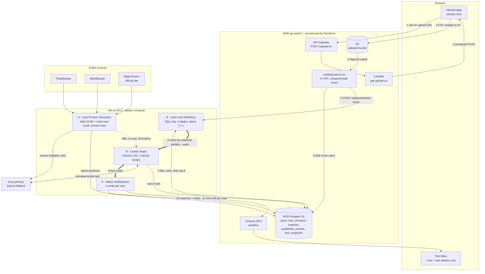

# Loan Eligibility Engine

Upload a CSV of users → crawl personal-loan products from the web → match every user to the lenders
they qualify for → email each user their best matches.

Built for the ClickPe engineering-internship assignment on **AWS (ap-south-1)** and a **self-hosted n8n**.
Everything is provisioned with Terraform, and the numbers below come from a real run on the supplied
10,000-user dataset.

| | |
|---|---|
| Users matched | **10,000** in **~17 s** (workflow B), upload → email in **~23 s** |
| Naive approach | 10,000 users × 45 lender records = **450,000** pairs |
| LLM calls in the matching path | **0** (naive LLM approach: 450,000) |
| LLM calls overall | one pass of **36** (one per lender, cached; unchanged lenders cost 0) |
| What each user gets | their **top 5** lenders, lowest rate first, with a credit-score check and lender conditions |

---

## 1. Architecture

One picture of the whole system: the AWS side, the four n8n workflows (A, B, R, C) and how they hand off.



**Reading it:** thin arrows are data, thick arrows are workflow hand-offs, the dotted arrow is the nightly
refresh. Steps 1-11 are what happens on every upload; A runs on its own schedule and keeps the lender data fresh.

### The four workflows

| | Workflow | Triggers | What it does | Nodes |
|---|---|---|---|---|
| **A** | Loan Product Discovery | schedule 02:00 daily, manual, `POST /webhook/crawl-now` | Reads three sources, pulls each lender's eligibility text, has an LLM turn it into per-employment-type numeric rules, upserts `loan_products`, then hands off to R | 21 |
| **B** | User-Loan Matching | `POST /webhook/batch-ready` (called by the parse-csv Lambda) | Multi-stage SQL funnel that matches 10,000 users and keeps each user's top 5. No LLM. Then calls R (waits) and C | 17 |
| **R** | Lender Notes | called by A and B, `POST /webhook/review-now`, manual | One LLM call per lender writes the short "good to know" note for each employment type it accepts. Cached by content hash, saved after every batch of 6 | 24 |
| **C** | Match Notifications | called by B, `POST /webhook/notify-now`, manual | One email per user via Amazon SES, to test aliases only; marks `notified_at` only after SES accepts | 15 |

The workflow JSON in [`n8n/workflows/`](n8n/workflows) is generated by [`scripts/build_workflows.py`](scripts/build_workflows.py)
from the tested Code-node sources in [`n8n/code/`](n8n/code) and the SQL in [`n8n/sql/`](n8n/sql). I verified that the
files in the repo are identical (nodes and connections) to what n8n exports from the running instance.

---

## 2. The Optimization Treasure Hunt

**The problem.** 10,000 users × 45 lender records is 450,000 user-lender pairs. Asking an LLM "does this user
qualify?" for each pair means 450,000 calls: hours of waiting and a large bill. Even one call per user is 10,000 calls.

**The idea.** Use the LLM only where the input is unstructured text (the lender's web page), once per lender, and
do all per-user work in SQL on numbers. Candidate pairs never leave Postgres, so n8n's memory is never the bottleneck.

| Stage | What it does | Pairs left | Time |
|---|---|---:|---:|
| naive | every user × every lender record | **450,000** | |
| 0 · reconcile lenders (Code node) | the same bank on several sites collapses to one record (45 → 34 lenders, 11 merged groups) | 340,000 | <1 s |
| 1 · envelope pre-filter (SQL) | a permissive min/max per lender (a NULL means "no stated limit") drops the clearly ineligible, written to a staging table | 266,532 | ~5 s |
| 2 · exact rules (SQL over JSON) | per-employment-type rules, e.g. ICICI: Salaried needs ₹30,000, Self-Employed has no income floor | 255,380 | ~2 s |
| 3 · rank, keep top 5 (SQL window function) | flagged-score matches last, then lowest rate, then widest credit-score margin | **50,000** | ~1 s |
| LLM calls in all of the above | | **0** | |

Whole workflow B on the real 10,000-user batch: **16-18 s** end to end including the network hop to RDS.

**Be honest about where the savings come from.** Most lenders state loose requirements, so the numeric filters only
remove about a quarter of the pairs (340,000 → 255,380). The big wins are (1) keeping the LLM out of the per-user path
entirely, (2) merging duplicate lenders, and (3) ranking to a top 5 so only 50,000 rows are written and mailed.

### What the LLM does, and how that is made cheap

The LLM reads lender web text twice, both times per lender and never per user:

1. **Extraction (workflow A):** eligibility text → structured rules (`min_income`, `min_credit_score`, `min_age`, `max_age`, per employment type). Only 2.5 KB of text per lender is sent, not an 800 KB page.
2. **Notes (workflow R):** a one-sentence "good to know" per employment type, e.g. *"You need at least 1 debit and 2 credit transactions a month in your main account."*

| Cost control | Effect |
|---|---|
| One call per lender, not per employment type | the prompt and lender text are sent once; 87 notes need only 36 calls |
| Cached by `md5(prompt version + lender text)` | unchanged lender → **0 calls**; only changed lenders are re-reviewed |
| Notes for matched lenders first | after an upload, R reviews only the lender + employment-type pairs in that batch's matches (17 segments for the test batch, 12 already cached), and the emails wait for exactly those |
| Everything else in the background | A asks R for all lenders after each crawl, so the cache is complete before any outlier user needs it |
| Saved after every batch of 6 | a restart or a rate limit loses at most one batch |
| Groq primary, Gemini fallback | two free-tier quotas; a model that runs dry can be swapped in one line |

**Users growing never costs more LLM calls.** Notes belong to a lender and an employment type, not a person.
Only a change in a lender's text triggers a re-review of that lender.

---

## 3. Repository layout

```
infra/                 Terraform: VPC wiring, RDS, S3, Lambdas, API Gateway, n8n EC2, SES, IAM
  serverless.yml       thin Serverless Framework definition of the Lambda layer (see Design Decisions)
lambdas/
  get_upload_url/      presigned S3 POST (size-capped, content-type pinned)
  parse_csv/           streams the CSV, validates, bulk-inserts; notifies n8n
db/migrations/         001-007, idempotent, applied by scripts/migrate.sh
n8n/
  workflows/           A, B, R, C (importable JSON)
  code/                Code-node sources + prompts, with Node unit tests in code/test/
  sql/                 every SQL statement the workflows run
  docker-compose.yml   n8n 2.44.4, pinned
ui/index.html          the upload page
scripts/               build, deploy, credentials, seeding, status and progress tools
docs/DEMO_CHECKLIST.md demo-video checklist
```

---

## 4. Setup and deployment

### Prerequisites
- AWS account with CLI credentials for **ap-south-1** (`aws configure`)
- Terraform ≥ 1.5, Docker (used for `psql`), Python 3.10+, Node 20+ (tests only)
- A **Groq** API key and a **Gemini** API key
- A Gmail address (SES sender + `+one` / `+two` test aliases)

### Steps

```bash
# 1. Configure (gitignored file)
cp infra/terraform.tfvars.example infra/terraform.tfvars
#    edit: my_ip_cidr (curl https://checkip.amazonaws.com), ses_sender_email, test_recipient_emails

# 2. Build the Lambdas and create all AWS infrastructure
./scripts/build_lambdas.sh
terraform -chdir=infra init && terraform -chdir=infra apply
#    -> also writes loan-engine-n8n.pem (gitignored) for SSH to the n8n host

# 3. Click the 3 SES verification links AWS emails to your Gmail (sender + two aliases).
#    SES in sandbox mode sends only to verified addresses.

# 4. Create the database schema
./scripts/migrate.sh

# 5. Open n8n (terraform -chdir=infra output n8n_url) and create the owner account.
#    n8n v2 has no basic-auth env vars: the first visitor becomes the owner, which is why port
#    5678 is locked to your IP by the security group.

# 6. Load credentials into n8n (see the table below), then deploy the workflows
GROQ_API_KEY=... GEMINI_API_KEY=... ./scripts/n8n_credentials.sh
./scripts/n8n_ses_credential.sh
./scripts/n8n_deploy_workflows.sh

# 7. Fetch lender data once, then fill the notes cache
curl -X POST http://<n8n-ip>:5678/webhook/crawl-now      # ~6 min; ends by starting workflow R
#    (or POST /webhook/review-now to run only the notes)

# 8. Upload the CSV
./scripts/write_ui_config.sh && python3 -m http.server 8000 --directory ui   # open localhost:8000

# 9. First time only: choose who gets emailed, then notify
./scripts/seed_test_recipients.sh                        # maps 2 real user_ids to your +one/+two aliases
curl -X POST http://<n8n-ip>:5678/webhook/notify-now
```

After step 9, every upload runs the whole chain by itself: upload → Lambda → B → R → C → email.

### Credentials, exactly as configured in n8n

`scripts/n8n_credentials.sh` and `scripts/n8n_ses_credential.sh` create these with **fixed ids**, so the workflow JSON
resolves them automatically. If you create them by hand in the UI instead (Credentials → Create), re-select each
credential on the nodes that use it.

| n8n credential (id) | Type | Fields | Where the value comes from |
|---|---|---|---|
| **Groq API** (`credGroq000000001`) | Header Auth | Name `Authorization`, Value `Bearer <key>` | your Groq key |
| **Gemini API** (`credGemini0000001`) | Header Auth | Name `x-goog-api-key`, Value `<key>` | your Gemini key |
| **Loan DB (RDS)** (`credPostgres00001`) | Postgres | host / port 5432 / database / user / password; **SSL = Require, "Ignore SSL Issues" ON** | `terraform output db_host db_name db_user` and `terraform output -raw db_password` |
| **AWS SES (send-only)** (`credAwsSes0000001`) | AWS (IAM) | region `ap-south-1`, access key id, secret | `terraform output ses_access_key_id` and `terraform output -raw ses_secret_access_key` |

### Environment variables and where each lives

| Variable | Where | Purpose |
|---|---|---|
| `my_ip_cidr`, `ses_sender_email`, `test_recipient_emails`, `aws_region`, `db_*`, `*_instance_type` | `infra/terraform.tfvars` (gitignored; example provided) | Terraform inputs |
| `GROQ_API_KEY`, `GEMINI_API_KEY` | your shell, only when running `n8n_credentials.sh` | stored by n8n as encrypted credentials; never written to a file |
| `UPLOAD_BUCKET`, `MAX_UPLOAD_BYTES` | set on the `get-upload-url` Lambda by Terraform | target bucket, 100 MB cap |
| `DB_HOST/PORT/NAME/USER/PASSWORD`, `N8N_WEBHOOK_URL` | set on the `parse-csv` Lambda by Terraform | database and the private n8n address |
| `N8N_ENCRYPTION_KEY`, `N8N_HOST`, `WEBHOOK_URL`, `GENERIC_TIMEZONE` | `/opt/n8n/.env` on the EC2 host, generated by Terraform ([template](n8n/.env.example)) | n8n runtime |

**No secret is committed.** `.env`, `*.tfvars`, `*.pem`, `tfstate`, `ui/config.js` and `data/` are gitignored.

### Operating it

```bash
./scripts/n8n_status.sh          # live list of workflow runs (or the editor's Executions tab)
./scripts/watch_reviews.sh       # live progress bar of the lender-notes cache
terraform -chdir=infra destroy   # tear everything down when finished (stops the AWS cost)
```

### Tests

```bash
node --test n8n/code/test/*.test.js                       # 38 tests: normalisers, reconciliation, email, review flow
cd lambdas/parse_csv && python3 -m unittest -v test_parse_csv   # 10 integration tests (needs a local Postgres, see the file header)
```

---

## 5. Design decisions

**Ingestion**
- **Presigned-POST upload, then an S3 event.** The browser uploads straight to S3, so API Gateway's 10 MB limit and Lambda's timeout never touch the file. The `batch_id` is embedded in the object key (`uploads/<batch_id>/<file>.csv`), so the first Lambda needs no database and no VPC.
- **Streamed, chunked load.** `parse-csv` streams the file and inserts 1,000 rows at a time with a single `unnest` statement and `ON CONFLICT DO NOTHING`; the row count is recomputed from the table, so retries are idempotent. The 10,000-row file loads in about 1 s.
- **`user_id` is the primary key, not email.** The dataset has 10,000 rows but only 2,632 distinct emails, so email would silently drop most users. Notifications are grouped per `user_id`.
- **Least-privilege networking.** Default VPC with no NAT; an S3 gateway endpoint; separate security groups so RDS accepts only the Lambda, n8n and my IP, and n8n's UI, SSH and webhook accept only my IP and the Lambda.

**Infrastructure**
- **Terraform is the deploy path; `serverless.yml` is a thin layer on top.** Terraform owns the VPC, RDS, S3, IAM, EC2 and the Lambdas. The assignment lists Serverless Framework for Lambda deployment, so `infra/serverless.yml` defines the same two functions, the HTTP API and the S3 trigger, reusing Terraform's IAM roles. It passes `serverless print` but I never deployed it, because deploying both tools to the same function names would conflict. Pick one deploy path per environment.
- **n8n on a `t3.micro` with docker compose, over plain HTTP.** Good enough for a take-home, with port 5678 locked to my IP. In production I would put it behind HTTPS (an ALB or Caddy) and a real domain.
- **DB password as a Lambda environment variable.** Simple and honest for this scope, but the value sits in Terraform state and the function config. Production would use Secrets Manager. State is local and gitignored.
- **n8n's Postgres credential is TLS-encrypted but not chain-verified.** The n8n credential cannot take a CA bundle; traffic stays inside the VPC. The Lambda does verify the RDS certificate with the bundled CA.
- **SES sandbox on purpose.** It only delivers to verified addresses, which is exactly the safety property required here.

**Matching**
- **Rules are per employment type.** Lenders differ by applicant (ICICI: salaried ₹30,000; self-employed none), so a single `min_income` per lender would be wrong. A permissive "envelope" (a NULL in any rule makes that bound NULL) makes Stage 1 a guaranteed superset of Stage 2.
- **Self-Employed implies Business.** Indian lenders use "self-employed" for professionals and non-professionals alike, while the CSV splits them into two categories, so a lender that accepts one accepts the other.
- **One record per lender, with an authority order.** The same bank appears on several sites with different thresholds. Eligibility rules come from the lender's own site first, then the record stating more criteria, then Paisabazaar before BankBazaar.
- **The rate is the lowest published across sources**, shown as "From X%". Aggregators disagree (Axis: 9.99% vs 8.75%) and a customer cares about the best published rate. The rate and the rules can therefore come from different sources.
- **Unstated is not "no limit".** Indian Bank states a 700 minimum for salaried applicants and nothing for self-employed ones. A 670-score self-employed user is **flagged** ("Check: your score is 670; 700 is required for other applicants"), ranked behind unflagged matches, and the email shows the score against the minimum.
- **Top 5, ranked.** Unflagged first, then lowest rate, then the widest credit-score margin. A user receives a short, useful list instead of 34 lenders.
- **The LLM annotates, it never removes.** A first version let the LLM veto segments; on real data it applied a salaried income floor to self-employed applicants and flipped between runs. So it may only mark a segment `eligible` or `conditional` with a caveat. An "ineligible" answer is demoted. Eligibility is decided only by exact SQL.

**Notifications**
- **Hard safety rail.** The notification query takes the recipient from `test_recipients` only and never selects `users.email`; users without a mapping are skipped. Real CSV addresses cannot be mailed.
- **Idempotent.** `notified_at` is set only for emails SES accepted, so a failed send is retried and a second run sends nothing.
- **Escaping.** Names and notes from the CSV or the web are HTML-escaped, and a newline in a name cannot inject a mail header.

---

## 6. Accuracy and known limitations

The matching logic is exact and verified: I re-derived every user's top 5 independently for all 10,000 users and found 0 differences. The data behind it is **public web text read by an LLM**, so the output is **indicative, not a guaranteed offer**.

- Extraction can miss a number, and a missing number becomes "no limit" (the score flag covers one important case, not all).
- Rates are headline "from" rates, not personalised offers; the lender decides.
- Most lenders publish no minimum credit score; the email says so ("Lender does not publish a minimum").
- The "good to know" notes are LLM-written. Spot checks found them faithful, but one framed a list of eligible groups as a condition.
- Free-tier LLM quotas are small and per model (Gemini ≈ 20 requests/day per model; Groq has per-minute and daily token caps). A throttled review simply retries on the next run, and no match depends on it.
- The crawler reads three public sources; Policybazaar redirects to Paisabazaar, so Bajaj Finserv's own site is the third.
- Not exercised live on AWS: the `webhook_failed` path (a failed n8n call from the Lambda) and the `serverless.yml` deployment.

---

## 7. Repository access

This repository is **private**. The four required reviewers must be invited as collaborators by the repository
owner (GitHub does not allow this to be scripted from the project): `ujjwalkala-clickpe`, `HarshSrivastav-Dailype`,
`ManishBiswal-clickpe`, `tushar-clickpe`. Settings → Collaborators → Add people.

After the demo: rotate the Groq and Gemini keys, and run `terraform destroy` to stop AWS charges.
